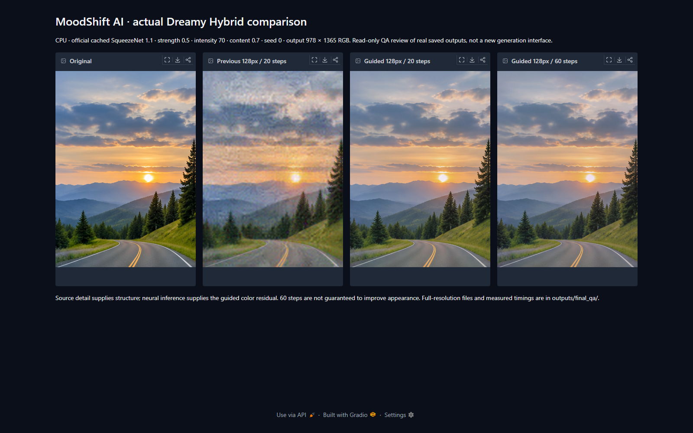

# MoodShift AI: project report

## 1. Introduction and problem statement

Changing a photograph's atmosphere involves color, tone and texture. A sunset can
be made warmer with image processing, whereas reference-guided neural styling can
introduce new textures. The challenge is to offer both methods honestly while
preserving recognizable scene structure. The final investigation addressed colored
cloud artifacts and blurred trees in a portrait landscape processed by Hybrid
Preview. This is an educational application, not a trained mood-recognition system.

## 2. Objectives

Provide safe local image handling, five reproducible photographic presets, genuine
reference-guided neural optimization, a scene-preserving hybrid, and an accessible
Gradio demonstration. Keep image operations, model code, orchestration and UI
separate. Verify correctness with generated-image tests and distinguish these tests
from real pretrained inference and subjective visual inspection.

## 3. Digital Image Processing concepts

Images are normalized to 8-bit RGB after bounded decoding and EXIF orientation.
Transparency is composited over white. Aspect-preserving LANCZOS resizing avoids
stretching. NumPy arrays use RGB channel order; explicit OpenCV conversions prevent
BGR confusion. CIELAB separates luminance from chromatic axes. Smooth tonal masks,
tone curves, controlled glow and seeded grain support photographic grading.
Export is explicit and does not overwrite existing files.

## 4. Deep learning architecture and pretrained model

The application uses TorchVision's SqueezeNet 1.1 with official
`IMAGENET1K_V1` weights. This is an ImageNet classifier reused as a frozen feature
extractor, not a model trained by this project to recognize moods. Intermediate
feature indices 1, 3, 6 and 9 supply style features; index 9 also supplies content
features. The classifier is not used. Inputs use ImageNet normalization without
the classification center crop. SqueezeNet's Fire modules combine squeeze and
expand convolutions to reduce model size [2, 3]. No classification accuracy is
claimed as a measure of this project's image quality.

## 5. Content loss, style loss and Gram matrices

Content loss compares spatial feature activations with mean squared error,
normalized by target feature energy (floor 0.0001). For a feature tensor flattened
to C channels and H×W positions, the Gram matrix is `F Fᵀ / (C H W)`. It describes
channel correlations without preserving each texture's original location. Style
loss averages target-energy-normalized Gram MSE across the four selected layers.
This follows the feature-based style-transfer principle of Gatys et al. [1], with
project-specific architecture, normalization and optimization choices. It does
not guarantee photographic realism or semantic understanding.

## 6. Neural optimization

Content pixels plus small seeded noise initialize the generated image. Only image
pixels receive updates; pretrained weights remain frozen. Adam uses learning rate
0.02. The objective is `10 × content_preservation × content_loss +
5 × style_strength × style_loss + 0.01 × total_variation`. Squared neighboring
differences discourage roughness. Finite-value checks, gradient clipping at 10,
and clamping to [0,1] guard execution. This is per-image optimization, not training
a new network. More iterations can change texture without improving appearance.

## 7. LAB grading and tonal adjustments

Presets adjust LAB chroma through smooth shadow, midtone and highlight masks.
Contrast, gamma, black lift and white point affect tone; saturation and vibrance
control color. Dreamy includes restrained bright-region bloom; Vintage optionally
adds deterministic grain. Gamut conversion clips values to displayable RGB.
Grade mode uses NumPy/OpenCV/Pillow and performs no neural inference.

## 8. Hybrid architecture and final quality correction

The previous Hybrid pipeline enlarged generated RGB pixels directly, then graded
and blended them. On the investigated 978×1365 image, Preview's internal result was
only 92×128: enlarging it approximately 10.7 times could not recover tree detail.
CNN optimization also introduced colored textures, so interpolation alone was
not the whole problem. Inspection found content initialization, feature
normalization, RGB channel handling and the single final blend consistent with
their intended implementation; these mechanisms were retained.

Hybrid now computes a low-resolution RGB residual `neural − resized_content`.
A grayscale source guide fits local linear coefficients `a` and `b` to each
residual channel. Box-window statistics use a 9×9 window and regularization 0.01
on [0,1] luminance. Averaged coefficients are bilinearly enlarged and evaluated
against full-resolution source luminance. Adding the resulting color correction
to original RGB retains source detail before the preset grade and one final
intensity blend. These guided-filter equations are adapted from He et al. [4].

This is deliberate texture suppression, not super-resolution, sharpening, or
invented detail. Neural inference still supplies the residual; metadata records
`content-guided-residual`. Pure Neural mode retains direct generated RGB and is
labeled `direct-rgb`. Zero neural strength skips inference truthfully. A hybrid
may resemble a grade when its guided neural correction is small.

## 9. Five presets

| Preset | Photographic intention |
| --- | --- |
| Cinematic | Cool shadows, warm highlights and stronger contrast |
| Sunset | Warm midtones/highlights and modest color enhancement |
| Cold Blue | Cool chroma and reduced saturation |
| Vintage | Lifted blacks, muted warm color and optional seeded grain |
| Dreamy | Softer contrast/color and controlled highlight glow |

Built-in neural references are deterministic synthetic patterns generated by the
project, not licensed photographs or learned mood embeddings. External references
replace these patterns. In Hybrid, the preset still determines the post-grade.
No preset recipe was changed during final QA: visual evidence supported fixing
reconstruction rather than adding further effects.

## 10. Implementation and technologies

Python 3.12 uses a `src/moodshift` package: `imaging` owns DIP operations;
`engine` owns pretrained features and optimization; `services` owns mode selection
and metadata; `ui` adapts inputs, displays comparisons and manages downloads.
Dependencies are PyTorch, TorchVision, OpenCV headless, Pillow, NumPy and Gradio;
Pytest and Ruff support development. No paid API is used. Weights are cached
locally and excluded from Git. Local QA reused existing weights without downloads.

## 11. Actual experiments and evidence

The same cached landscape was used throughout (978×1365). SHA256 of the encoded
source: `60518730c9cffe5dc190cc52a6256a7c19b49942d5ac86360ec999649d91affa`.
Dreamy used CPU, two PyTorch threads, seed 0, synthetic Dreamy reference,
neural strength 0.5, content preservation 0.7 and final intensity 70.
Intensity 70 is an explicitly chosen experiment setting; the original reported
UI metadata did not establish its intensity. Each old/new pair shares the exact
same real CNN result, isolating reconstruction from optimization randomness.

| Maximum neural axis | Actual grid | Steps | Neural seconds | Previous detail error | Guided detail error |
| --- | --- | --- | --- | --- | --- |
| 128 | 92×128 | 20 | 1.763 | 1.438 | 0.413 |
| 128 | 92×128 | 60 | 3.662 | 1.407 | 0.468 |
| 256 | 183×256 | 20 | 3.466 | 2.138 | 0.396 |
| 256 | 183×256 | 60 | 9.091 | 1.916 | 0.449 |
| 384 | 275×384 | 20 | 7.778 | 3.033 | 0.394 |
| 384 | 275×384 | 60 | 21.279 | 2.553 | 0.441 |

Times are single observations including temporary reference creation; the first
also includes lazy model loading. They exclude reconstruction, grade, export and
UI transport. They are not reproducible performance guarantees. Detail error is
mean absolute difference of RGB high-pass residuals from the source, using Gaussian
sigma 2 and uint8-scale values. It measures content-detail distortion, not artistic
success. A completely unchanged image scores zero, so this metric cannot establish
neural style quality. At 128/20, error fell about 71% with guided reconstruction.

Visual review of full views and tree/mountain crops showed reduced colored cloud
texture and retained source edges. The guided 20- and 60-step images both preserve
detail; 60 steps is not an unqualified visual improvement. Higher resolution costs
more and changes the correction, but no universal aesthetic advantage was found.
The CPU Preview budget remains 20/128. Balanced is 60/256; High remains 120/384.
The controlled table tests 20/60 at each grid, not the default High 120-step preset.

### Genuine local screenshots and outputs

Selected documentation screenshots are included in `evidence/`. Full-resolution
experimental outputs and raw CNN grids stay in ignored `outputs/final_qa/`.
Confirm source-image permissions before distributing the report or evidence.
A checkout contains the selected screenshots but not the full generated outputs.



This is a genuine Chrome screenshot of a read-only QA comparison view populated
with saved outputs, not a screenshot of a live generation completing in the main
app. The settings in its caption match the experiment above.


This generated comparison panel shows original, previous 128/20, guided 128/20,
and guided 256/60. It is a panel of actual pixels, not a browser screenshot.
Full-resolution [Cinematic Grade](../../outputs/final_qa/cinematic-grade.png),
[Sunset Grade](../../outputs/final_qa/sunset-grade.png),
[Dreamy Hybrid 20](../../outputs/final_qa/new-128-20.png),
[Dreamy Hybrid 60](../../outputs/final_qa/new-128-60.png), and
[Neural Transfer](../../outputs/final_qa/neural-transfer.png) are available locally.
The Neural comparison uses Dreamy synthetic reference, 256/60 and intensity 70,
without a photographic post-grade or guided reconstruction.

Reproduce the six-run experiment with the same source (or supply your own):

```powershell
$env:TORCH_HOME = Join-Path (Get-Location) '.cache\torch'
.venv\Scripts\python scripts\quality_comparison.py path\to\landscape.jpg --output outputs\quality-rerun
```

The output directory must be new. The tree crop coordinates are specific to this
landscape; numerical experiments accept other valid images. See TEST_SUMMARY.md
for unit, integration, HTTP and browser evidence and their separate limits.

## 12. Limitations and future improvements

Evaluation covers one real landscape and small synthetic fixtures, not a broad
photographic benchmark or human study. Neural-only output can remain noisy or
abstract; Hybrid sacrifices transferred texture to preserve the scene. No model
was trained for photo-realistic mood transfer. Bright clipping, extreme references
and thin structures can still cause problems. Images are 8-bit RGB without managed
ICC/HDR workflows. CUDA is unavailable in the installed CPU build and unverified.
Downloads are temporary; production deployment, automatic mood recognition,
larger perceptual evaluation and controlled parameter tuning remain future work.

## 13. Conclusion

MoodShift AI combines explicit DIP grading with real frozen-CNN-guided image
optimization. Final experiments traced the reported Hybrid artifact to generated
low-resolution texture being enlarged into a photograph. Guided neural residual
reconstruction substantially improves preservation on the investigated scene
without claiming new learned detail. Correctness checks and visual evidence are
reported separately from unmeasured aesthetic generalization.

## 14. References and attribution

1. Gatys, L. A., Ecker, A. S., and Bethge, M. (2016). *Image Style Transfer Using
   Convolutional Neural Networks*. CVPR, 2414–2423.
   [Primary publication](https://www.cv-foundation.org/openaccess/content_cvpr_2016/html/Gatys_Image_Style_Transfer_CVPR_2016_paper.html).
2. Iandola, F. N., Han, S., Moskewicz, M. W., Ashraf, K., Dally, W. J., and Keutzer,
   K. (2016). *SqueezeNet: AlexNet-level accuracy with 50x fewer parameters and
   <0.5MB model size*. arXiv:1602.07360. [Paper](https://arxiv.org/abs/1602.07360).
   The title describes the research paper; this project does not use a 0.5MB
   compressed checkpoint or reproduce its classification experiments.
3. TorchVision. [SqueezeNet 1.1 model and weight documentation](https://docs.pytorch.org/vision/main/models/generated/torchvision.models.squeezenet1_1.html).
   Official `IMAGENET1K_V1` pretrained weights, not project-trained weights.
4. He, K., Sun, J., and Tang, X. (2010). *Guided Image Filtering*. ECCV.
   [Authors' project and paper links](https://people.csail.mit.edu/kaiming/eccv10/index.html).
5. PyTorch. [Neural transfer tutorial](https://docs.pytorch.org/tutorials/advanced/neural_style_tutorial.html).
   Background on optimization through frozen features; this project uses
   SqueezeNet/Adam rather than the tutorial's VGG/LBFGS combination.

Project contributions are the package architecture, validated image pipeline,
grading recipes, service/UI integration, guided residual application, tests and
local evaluation. SqueezeNet, its ImageNet-trained parameters, the style-transfer
principle and guided-filter mathematics are third-party contributions. Source
photo authorship/license has not been established by this QA session; no claim
of original photographic authorship or redistribution permission is made.
