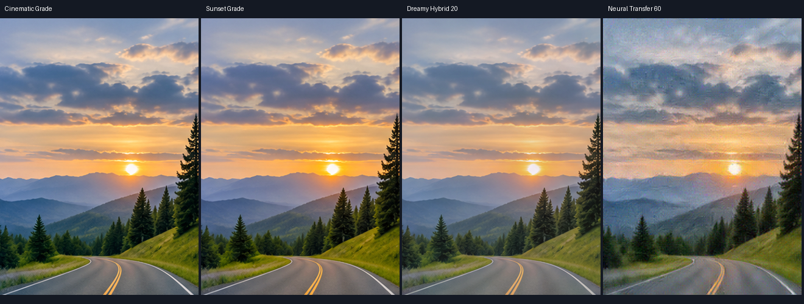
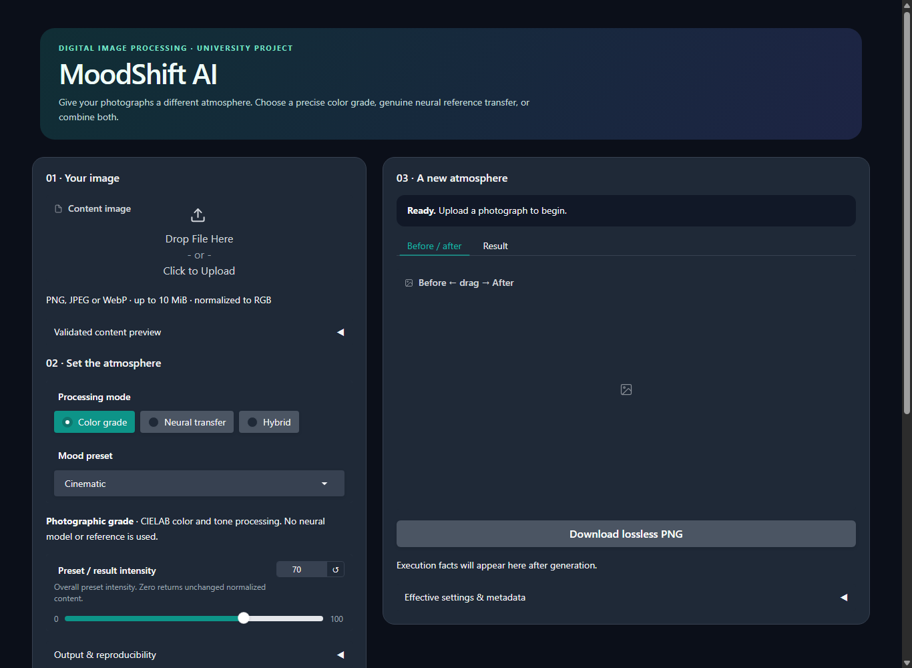

# Final QA: actual results

## Environment and commands

Windows workstation; existing Python 3.12.10 virtual environment; CPU-only
PyTorch 2.10.0+cpu, TorchVision 0.25.0+cpu, Gradio 6.32.0. Existing official
SqueezeNet 1.1 checkpoint reused from `.cache/torch`; no weights downloaded.
No Python reinstall, virtual-environment replacement or global version change.

From the repository root, actual checks used:

```powershell
.venv\Scripts\python -m pytest -q
.venv\Scripts\python -m ruff check .
.venv\Scripts\python -m ruff format --check .
.venv\Scripts\python -m pip check
git diff --check
$env:TORCH_HOME = Join-Path (Get-Location) '.cache\torch'
$env:MOODSHIFT_RUN_INTEGRATION = '1'
.venv\Scripts\python -m pytest tests/engine -m integration -q
```

| Check | Observed result |
| --- | --- |
| Ordinary suite | 236 passed, 3 skipped |
| Separate cached pretrained integration | 3 passed, 45 deselected |
| Ruff lint | Passed |
| Ruff formatting | Passed |
| Dependency consistency | No broken requirements found |
| Git whitespace check | Passed; Git may print LF→CRLF normalization notices |

Ordinary skips are one engine and two service real-model tests, intentionally
requiring `MOODSHIFT_RUN_INTEGRATION=1`. The separate command actually executes
all three with cached weights. Unit-test doubles are used only for isolation,
never as evidence of pretrained inference. No Pytest cache WinError 5 warning
appeared in these runs; no permission or cache deletion workaround was needed.

## Real Gradio HTTP smoke test

`outputs/final_qa/smoke_ui.py` launched the actual local app and used Gradio's
client to upload files, invoke `/generate`, retrieve comparison files and download
results. All **15 combinations** of grade/neural/hybrid and Cinematic/Sunset/
Cold Blue/Vintage/Dreamy passed. The generated fixture was 96×72; an explicit
48-pixel output limit produced 48×36 RGB downloads. Neural cases used two actual
CPU optimization steps, strength 0.6, intensity 70, content preservation 0.7,
seed 0, and synthetic references. These short runs establish wiring, not style
quality. The six longer photographic experiments are reported separately.

Assertions verified actual engine/device/reference metadata and matched-size
before/after image pairs. Additional real requests verified missing-input and
corrupt-file errors clear result output, two distinct uploaded references change
Neural output, repeated generation succeeds, download paths differ, and the exact
same cached pretrained extractor instance is reused. Two further real Hybrid
requests independently confirmed reference influence after guided reconstruction:
mean absolute channel difference 0.214120/255 at 4 steps and a 48-pixel limit.
The JSON evidence is `outputs/final_qa/http-smoke.json`.

The UI logs `ValueError` and `UnsupportedImageError` for the intentional invalid
requests; these are expected negative-test outcomes, not unexpected failures.
UUID download isolation handles repeated requests; exclusive-export collision
rejection and preservation of existing files are also covered by the ordinary
image I/O tests. This is not a concurrent-load or production security assessment.

## Photographic quality review

Six real CPU runs compared 20/60 steps at 128/256/384 maximum axes. Old and new
reconstruction used identical real CNN outputs. See PROJECT_REPORT.md for all
settings, timings, source hash and metric definition. Hybrid cloud noise and loss
of tree detail visibly improved; source high-frequency distortion fell at every
tested combination. Guided 20 steps was not inferior to 60 by the chosen detail
diagnostic. No universal quality improvement from resolution/steps is claimed.



The panel shows real Cinematic Grade, Sunset Grade, Dreamy Hybrid Preview and
Neural Transfer outputs. Grading remains structurally clean; Sunset is visibly
warmer, Cinematic retains cooler shadows, and Dreamy Hybrid is softer while
retaining scene detail. Neural-only retains visibly colored texture artifacts:
its direct artistic reconstruction has not been presented as a clean photograph.

## Actual browser inspection

Chrome headless rendered the main Gradio application at 1366×1000 and 800×1000.
The laptop layout displays side-by-side controls/results; the narrower layout
wraps into a single column. The existing dark theme, spacing and label hierarchy
were retained. No visual redesign was justified by this inspection. Copy now
explains guided reconstruction and removes obsolete later-milestone wording.



This main-app screenshot is the initial state. Interaction/download assertions
were performed through real HTTP, not automated browser clicks. The separate
Chrome before/after screenshot in PROJECT_REPORT.md is a read-only QA review of
actual generated files. No claim is made that it captures the main app completing
a generation. Touch-device behavior and every browser/viewport remain unverified.

## Evidence and limits

Selected screenshots are included under `docs/submission/evidence/`. Full-size
outputs, raw neural grids, scripts used for local HTTP/browser smoke checks and
JSON experiment results are under ignored `outputs/final_qa/`. The maintained
`scripts/quality_comparison.py` reproduces quality experiments offline with a
provided image. Existing source inputs were read locally; no original was saved
over. Weights, generated full-resolution images, temporary files and secrets stay
excluded from Git. No paid service, Git commit, push or remote change was used.

Remaining limits: CUDA untested, no broad photographic dataset/user study,
Neural-only artifacts, possible clipping, 8-bit RGB, and source-photo redistribution
rights to confirm before publishing the evidence. Local correctness and CPU
integration passed; these results do not establish production readiness.
